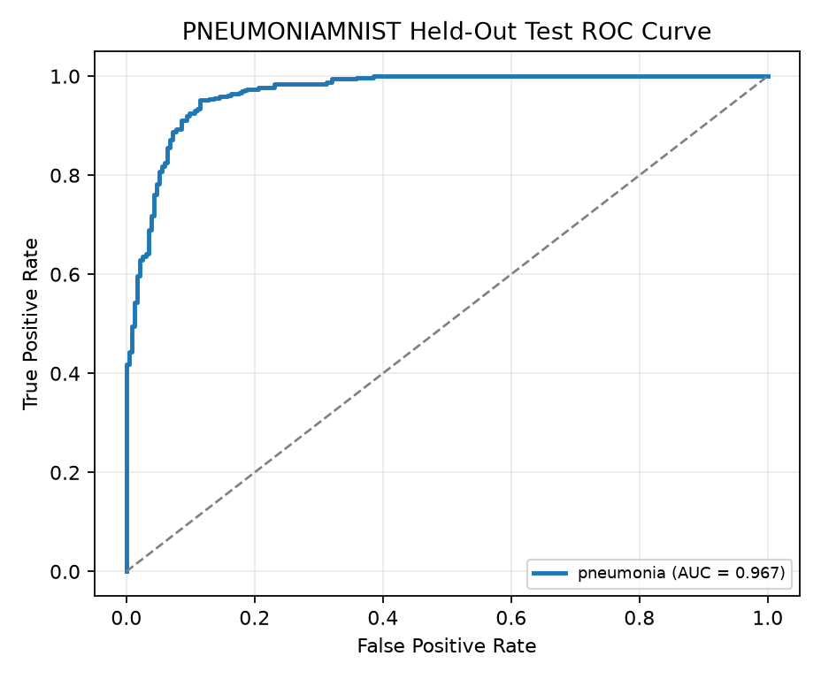
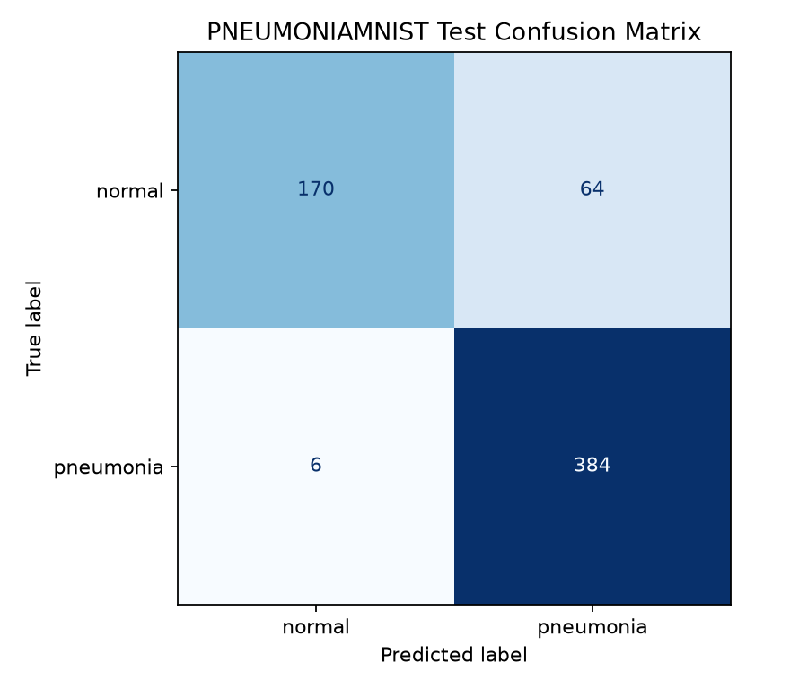
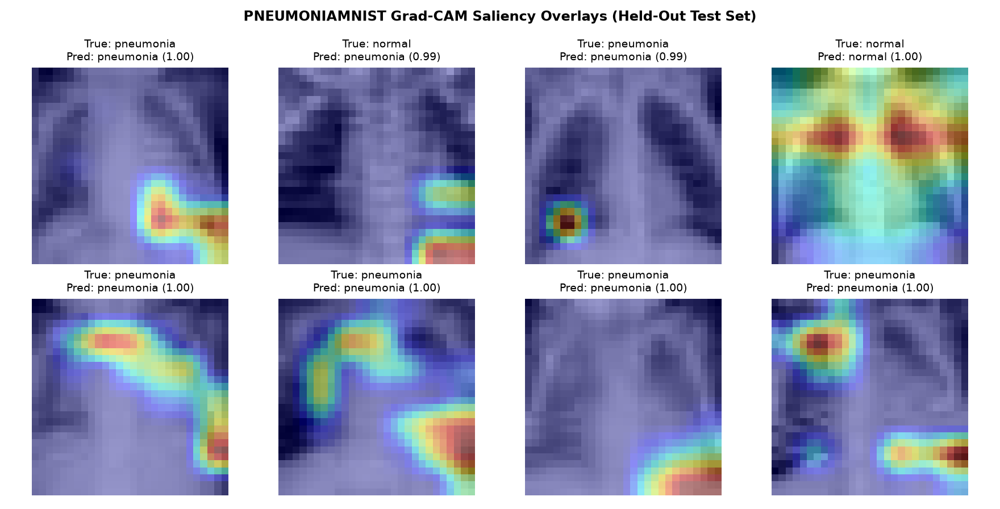

# MedMNIST PyTorch Classifier & Grad-CAM Explainability

A modular PyTorch deep learning pipeline for 2D medical image classification with class-weighted training, held-out ROC-AUC evaluation, and a custom pure-PyTorch Grad-CAM implementation for clinical saliency visualisations.

## Highlights
- **Custom Residual CNN (`MedResNet`):** Lightweight 3-stage residual convolutional architecture (`Conv2d`, `BatchNorm2d`, projection skip connections, global average pooling, dropout) supporting both greyscale and RGB medical imaging benchmarks (`PneumoniaMNIST`, `BreastMNIST`, `PathMNIST`, `OrganAMNIST`).
- **Imbalance-Aware Training:** Computes inverse-frequency class weights from the training split for weighted `CrossEntropyLoss`, paired with `AdamW`, cosine annealing learning-rate decay, and best validation ROC-AUC checkpointing.
- **Pure-PyTorch Grad-CAM:** Implemented from scratch using forward and full backward PyTorch hooks on the final convolutional layer to highlight image regions driving each prediction.
- **Tested & Reproducible:** Deterministic seeding and `pytest` unit tests covering model shapes, Grad-CAM normalisation bounds, and weight updates.

## Held-Out Test Results (`PneumoniaMNIST`, 10 Epochs on CPU)

| Split | Samples | Accuracy | Macro F1 | ROC-AUC |
| :--- | :---: | :---: | :---: | :---: |
| **Validation (Best Checkpoint)** | 524 | 97.14% | 0.9637 | **0.9968** |
| **Held-Out Test Set** | 624 | 88.78% | 0.8729 | **0.9673** |

*(Training split: 4,708 paediatric chest X-rays. Full epoch-by-epoch metrics are logged in [`results/metrics.json`](results/metrics.json).)*

### Evaluation & Explainability Figures

| ROC Curve | Confusion Matrix |
| :---: | :---: |
|  |  |



## Project Structure

```text
medmnist-pytorch-classifier/
├── src/
│   ├── data.py        # MedMNIST 2D DataLoaders, augmentations, class weights
│   ├── model.py       # MedResNet residual CNN architecture
│   ├── gradcam.py     # Pure-PyTorch Grad-CAM via forward/backward hooks
│   ├── train.py       # CLI training loop with validation ROC-AUC checkpointing
│   └── evaluate.py    # Test ROC curve, confusion matrix, and Grad-CAM plots
├── tests/
│   └── test_model.py  # Unit tests for forward shapes, Grad-CAM, and training step
├── results/           # Metrics JSON and generated evaluation plots
└── requirements.txt
```

## Quick Start

```bash
python -m venv .venv
source .venv/bin/activate  # Windows PowerShell: .\.venv\Scripts\Activate.ps1
pip install -r requirements.txt

# Run unit tests
pytest -v

# Train on PneumoniaMNIST (or pass --dataset breastmnist / pathmnist / organamnist)
python -m src.train --dataset pneumoniamnist --epochs 10 --batch-size 64

# Evaluate best checkpoint and generate plots
python -m src.evaluate --checkpoint checkpoints/pneumoniamnist_best.pt
```

## Licence
MIT License - see [`LICENSE`](LICENSE).
